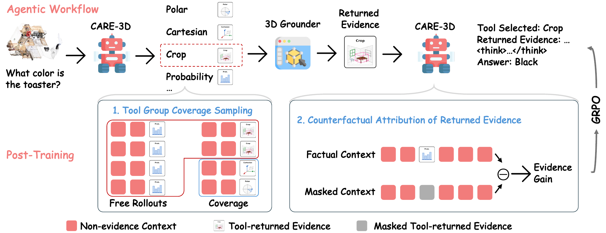

<h2 align="center">
  <b>CARE-3D: Reinforcement Learning for Evidence Grounded Agentic Reasoning in Situated 3D Scenes</b>
</h2>

<div align="center">

<a target="_blank" rel="external nofollow noopener" href="https://arxiv.org/abs/2611.29969"></a>
</div>
&nbsp;

<div align="center" margin-bottom="6em">
<a target="_blank" rel="external nofollow noopener" href="https://www.linkedin.com/in/xiaoqian-hu-69a575241/">Xiaoqian Hu</a>,
<a target="_blank" rel="external nofollow noopener" href="https://ruihongqiu.github.io/">Ruihong Qiu</a>,
<a target="_blank" rel="external nofollow noopener" href="https://yanran-tang.github.io/">Yanran Tang</a>,
<a target="_blank" rel="external nofollow noopener" href="https://csenw.github.io/">Sen Wang</a>
</div>
<h3 align="center">The University of Queensland</h3>

<div align="center">

<br>
<i>Overview of CARE-3D</i>
</div>

<b>CARE-3D</b> is a reinforcement post-training framework for situated 3D question answering. Given a question and the observer’s context, a Qwen3-VL-4B agent first selects a grounding tool and queries the scene, then uses the returned evidence to answer. After supervised fine-tuning, the agent is optimized with GRPO using two components: Counterfactual Attribution of Returned Evidence (CARE), which measures how masking the returned evidence changes the likelihood of the correct answer, and Group Coverage Sampling (GCS), which adds rollouts for tools the policy selects less frequently. We evaluate CARE-3D on MSQA and Beacon3D.

## 🔥 News
- \[2026-11\] CARE-3D is accepted to EACL 2027 Findings 🎉
- \[2026-11\] Training and evaluation code released

## 🚀 Get Started


1. Clone the repository and create the environment.
```shell
git clone https://github.com/xiaoqian-UQ/CARE-3D
cd CARE-3D
bash scripts/setup/install_env.sh    # creates the conda env "care3d"
conda activate care3d
```

2. Download pretrained weights and data.
```shell
bash scripts/data/download_models.sh    # Qwen3-VL-4B-Instruct, PQ3D, CLIP (~12 GB)
bash scripts/data/download_data.sh      # SceneCOT-185K (~16 GB)
bash scripts/data/build_rl_parquet.sh   # verl parquet files for GRPO / evaluation
```

Data, weights and outputs default to `./data_assets`, `./model_assets` and `./outputs`; override
with `SCENECOT_DATA_ROOT`, `SCENECOT_MODEL_ROOT` and `SCENECOT_EXP_ROOT`.

## 🕹 Training

```shell
# SFT
bash scripts/sft/train_sft.sh
bash scripts/sft/export_for_rl.sh

# GRPO with COAC + GCS (600 steps)
export GEMINI_API_KEY=...    # answer judge: gemini-2.5-flash-lite
bash scripts/rl/train_care3d.sh
```

## 📊 Evaluation

MSQA and Beacon3D (GQA3D) test sets, scored with GPT-Score (`gpt-4o-2024-11-20`):
```shell
bash scripts/eval/eval_checkpoint.sh --actor-dir checkpoints/care3d_qwen3vl4b/global_step_600/actor --name care3d
export OPENAI_API_KEY=...
bash scripts/eval/score_gpt.sh care3d
```


## 📝 TODO List

- [x] Training code
- [x] Evaluation code
- [x] arXiv paper

## 📜 Citation

If you find our paper useful in your research, please consider citing:

```bibtex
@inproceedings{hu2027care3d,
  title     = {CARE-3D: Reinforcement Learning for Evidence Grounded Agentic Reasoning in Situated 3D Scenes},
  author    = {Hu, Xiaoqian and Qiu, Ruihong and Tang, Yanran and Wang, Sen},
  booktitle = {Findings of the Association for Computational Linguistics: EACL 2027},
  year      = {2027},
  url       = {https://arxiv.org/abs/2611.29969}
}
```

## ⚖️ License

This project is released under the [Apache License 2.0](LICENSE). The vendored [`verl/`](verl) keeps its own
Apache-2.0 license and notice. Parts of the code are adapted from
[SceneCOT](https://github.com/SceneCOT/scenecot) (Apache-2.0),
[LEO](https://github.com/embodied-generalist/embodied-generalist) (MIT),
[PQ3D](https://github.com/PQ3D/PQ3D) (MIT), [SceneVerse](https://github.com/scene-verse/SceneVerse) (MIT) and
[Pointnet2_PyTorch](https://github.com/erikwijmans/Pointnet2_PyTorch) (Unlicense).
The [SceneCOT data](https://huggingface.co/datasets/EricLHK/SceneCOT) used for training and evaluation are
released under CC BY-NC 4.0 and may only be used for non-commercial purposes.
